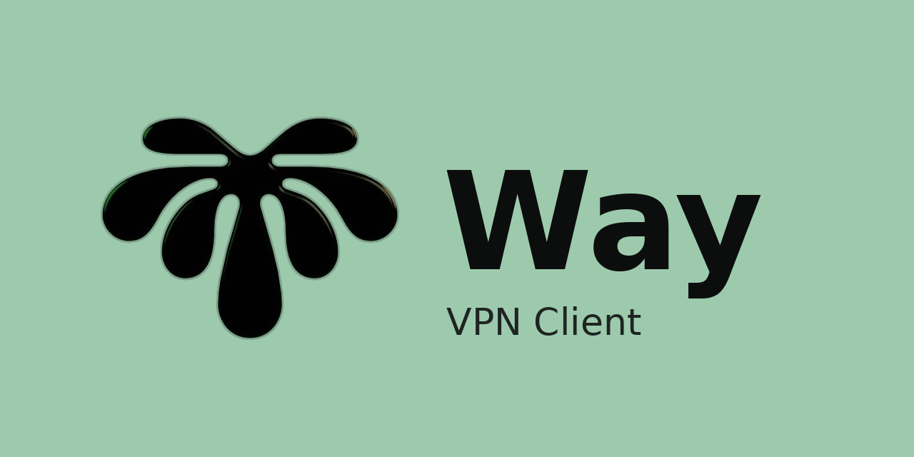

<p align="center">
  
</p>

<h1 align="center">Way</h1>

<p align="center">
  <b>EN</b> · <a href="#way-на-русском">RU</a>
</p>

<p align="center">
  <a href="https://github.com/mel0k1/way/actions/workflows/build.yml"></a>
  
  
  
  
  <a href="LICENSE"></a>
</p>

---

**Way** is a cross-platform VPN client built with **Flutter** (Material Design 3) and **Go**, powered by two engines: [sing-box](https://github.com/SagerNet/sing-box) and [Xray-core](https://github.com/XTLS/Xray-core). Switch cores any time without re-importing your servers.

## Features

- **Two cores in one app**: sing-box and Xray-core, one tap in Settings to switch
- **Tunneling**: full-device TUN (Android VpnService, Windows TUN), kill switch (WFP firewall on Windows, Always-on VPN + lockdown on Android), split tunneling per app or per process
- **Routing**: presets (all via VPN, RU direct via geosite/geoip, ad blocking), custom domain/IP/port rules with per-rule action (VPN, direct, block)
- **Protocols**: VLESS (+ Reality, Vision, uTLS), VMess, Trojan, Shadowsocks incl. 2022, Hysteria2, TUIC, AnyTLS; WS/gRPC/HTTP transports; TLS ClientHello fragmentation and h2mux/smux/yamux muxing (sing-box)
- **Proxy chaining**: route any server through another (sing-box `dialer_proxy`)
- **Subscriptions**: import by URL, QR or clipboard; auto-refresh on a configurable interval (honors `profile-update-interval`); v2ray link lists (plain/base64), sing-box JSON, Clash/Meta YAML and wrapper links of other clients (`clash://`, `sing-box://`, `v2rayng://`, `sn://`, `hiddify://`)
- **Deep links**: tap `vless://` / `vmess://` / `trojan://` / `ss://` / `hysteria2://` / `tuic://` / `anytls://` or `way://import/<url>` to import instantly (Android and Windows)
- **Profiles**: manual entry or raw sing-box outbound JSON, QR/link export, JSON backup and restore
- **Fastest server**: urltest group in sing-box plus real latency probing through the proxy (temporary core instance per server), auto-select
- **Cloudflare WARP**: free WireGuard tunnel registered right in the app
- **Networking extras**: custom DoH server with IPv4/IPv6 strategy, local socks/http proxy on Android (127.0.0.1:2080, no VPN permission), external IP and country of the active server, live speed and traffic stats via the clash API
- **Desktop**: Windows tray with quick connect and close-to-tray, state-colored tray icon, toasts, NSIS installer; Android quick settings tile and foreground notification with a disconnect button and session timer
- **Reliability**: watchdog rebuilds the tunnel after drops, network switches and system sleep; app-side reconnect with exponential backoff; autostart on boot or sign-in; profiles and subscription keys in encrypted storage (Keystore / DPAPI); update check against GitHub Releases
- **Battery**: one-tap exemption from Android battery optimization so the background VPN survives

## Supported protocols

| Protocol | sing-box | xray |
| --- | :-: | :-: |
| VLESS (+ Reality, Vision, uTLS) | ✔ | ✔ |
| VMess | ✔ | ✔ |
| Trojan | ✔ | ✔ |
| Shadowsocks (incl. 2022) | ✔ | ✔ |
| Hysteria2 | ✔ | — |
| TUIC | ✔ | — |
| AnyTLS | ✔ | — |
| WS / gRPC / HTTP transports | ✔ | ✔ |

Links are parsed automatically, one by one or as a whole base64 subscription; sing-box JSON and Clash YAML bodies work the same way.

## Architecture

```
┌───────────────────────────── Flutter (MD3) ─────────────────────────────┐
│  home · servers · subscriptions · logs · settings (RU/EN, themes)       │
└──────────────┬───────────────────────────────────────────┬──────────────┘
               │ MethodChannel (Android)                   │ HTTP (desktop)
┌──────────────▼───────────────────┐   ┌───────────────────▼──────────────┐
│  WayVpnService (Kotlin)          │   │  waycore.exe (Go daemon)         │
│  libbox · VpnService · protect   │   │  /start /stop /status /ping      │
└──────────────┬───────────────────┘   └───────────────────┬──────────────┘
               │           ┌──────────────────────────────┐│
               └──────────►│  waycore (Go engine manager) │◄───────────────
                           │  sing-box  ──  xray-core     │
                           └──────────────────────────────┘
```

- `core/`: Go module with the engine manager, xray controller, HTTP control API and Windows system proxy
- `lib/`: Flutter app (link parser, config builder for both cores, subscriptions, MD3 UI)
- `android/`, `windows/`: platform projects with the VpnService integration
- `installer/`: NSIS script for the Windows installer

## Download

Grab the latest APK and `WaySetup.exe` from [Releases](https://github.com/mel0k1/way/releases) or from the CI artifacts of every commit.

> Windows TUN mode requires administrator rights. Without them, use the proxy mode (system proxy is configured automatically).

## Build from source

Requirements: Go 1.27+, Flutter 3.47+, JDK 17, Android SDK/NDK (for Android).

```bash
git clone https://github.com/mel0k1/way.git
cd way

flutter pub get
flutter build apk --release
flutter build windows --release
```

The Go core is built automatically by CI; to build it manually:

```bash
cd core
go build -tags "with_gvisor,with_quic,with_utls,with_clash_api" -o waycore.exe ./cmd/waycore
```

## Linux (Arch / EndeavourOS)

The same Flutter app on GTK3 with a libayatana-appindicator tray:

- System proxy via `gsettings` (GNOME) or `kwriteconfig` (KDE Plasma); other desktops still get a local mixed proxy on 127.0.0.1:2080
- Arch package (`packaging/linux/PKGBUILD` + `way.desktop`): installs to `/opt/way`, launcher in `/usr/bin`, `cap_net_admin` granted to the core for TUN; CI publishes a `tar.gz` and an AppImage per release
- Tray menu (open/connect/disconnect/quit), backup import/export, `xdg-open` links and in-app update checks (AppImage asset) work on Linux
- The bundled `waycore` binary contains both engines, no separate core installation needed. Kill Switch is Windows-only

Build locally on Arch:

```bash
sudo pacman -S --needed go ninja cmake clang gtk3 libayatana-appindicator pkgconf
# flutter: `flutter-bin` from AUR, or the official tarball from flutter.dev
git clone https://github.com/mel0k1/way.git
cd way/core
go build -tags "with_gvisor,with_quic,with_utls,with_clash_api,with_wireguard" -o ../waycore ./cmd/waycore
cd ..
flutter pub get
flutter build linux --release
./build/linux/x64/release/bundle/way
```

For TUN mode without root, grant the core the network capability:

```bash
sudo setcap cap_net_admin,cap_net_bind_service+ep waycore
```

## Disclaimer

This project is a client shell around open-source cores. It ships no servers, no keys and no default configurations. Use it in accordance with the laws of your jurisdiction.

## License

[GPL-3.0](LICENSE). Way depends on sing-box (GPLv3) and Xray-core.

---

<a id="way-на-русском"></a>

<p align="center"></p>

## Way на русском

Кроссплатформенный VPN-клиент **Way** на **Flutter** (Material Design 3) и **Go** с двумя движками: [sing-box](https://github.com/SagerNet/sing-box) и [Xray-core](https://github.com/XTLS/Xray-core). Переключение между ядрами в один тап, без реимпорта серверов.

### Возможности

- **Два ядра в одном приложении**: sing-box и Xray-core, выбор движка в настройках
- **Туннелирование**: полный TUN (VpnService на Android, системный TUN на Windows), kill switch (WFP-фаервол на Windows, Always-on VPN + блокировка на Android), раздельное туннелирование по приложениям или процессам
- **Маршрутизация**: пресеты (всё через VPN, RU напрямую через geosite/geoip, блокировка рекламы), свои правила для доменов, IP и портов с действием на каждое (через VPN, напрямую, блокировать)
- **Протоколы**: VLESS (+ Reality, Vision, uTLS), VMess, Trojan, Shadowsocks вкл. 2022, Hysteria2, TUIC, AnyTLS; транспорты WS/gRPC/HTTP; фрагментация ClientHello и mux h2mux/smux/yamux (sing-box)
- **Цепочки прокси**: маршрут через выбранный сервер поверх текущего (sing-box `dialer_proxy`)
- **Подписки**: импорт по ссылке, QR или из буфера; автообновление с настраиваемым интервалом (с учётом `profile-update-interval`); списки v2ray-ссылок (plain/base64), sing-box JSON, Clash/Meta YAML и обёртки других клиентов (`clash://`, `sing-box://`, `v2rayng://`, `sn://`, `hiddify://`)
- **Диплинки**: клик по `vless://` / `vmess://` / `trojan://` / `ss://` / `hysteria2://` / `tuic://` / `anytls://` или `way://import/<url>` мгновенно импортирует профиль (Android и Windows)
- **Профили**: ручной ввод или сырой sing-box outbound JSON, экспорт в QR/ссылку, бэкап и восстановление в JSON
- **Быстрейший сервер**: urltest-группа в sing-box плюс реальный замер задержки через прокси (временный инстанс ядра на сервер), автовыбор
- **Cloudflare WARP**: бесплатный WireGuard-туннель, регистрируется прямо в приложении
- **Сеть**: свой DoH-сервер со стратегией IPv4/IPv6, локальный socks/http-прокси на Android (127.0.0.1:2080, без разрешения VPN), внешний IP и страна активного сервера, живая скорость и трафик через clash API
- **Десктоп**: трей Windows с быстрым подключением и скрытием окна, иконка-статус, тосты, NSIS-установщик; плитка быстрых настроек и нотификация Android с кнопкой отключения и таймером сессии
- **Надёжность**: watchdog пересобирает туннель после обрыва, смены сети и сна системы; переподключение с экспоненциальной задержкой; автозапуск после загрузки или входа в систему; профили и ключи подписок в шифрованном хранилище (Keystore / DPAPI); проверка обновлений с GitHub Releases
- **Батарея**: исключение из оптимизации в один тап, чтобы фоновый VPN не убивался

### Поддерживаемые протоколы

| Протокол | sing-box | xray |
| --- | :-: | :-: |
| VLESS (+ Reality, Vision, uTLS) | ✔ | ✔ |
| VMess | ✔ | ✔ |
| Trojan | ✔ | ✔ |
| Shadowsocks (вкл. 2022) | ✔ | ✔ |
| Hysteria2 | ✔ | — |
| TUIC | ✔ | — |
| AnyTLS | ✔ | — |
| Транспорты WS / gRPC / HTTP | ✔ | ✔ |

Ссылки парсятся автоматически, по одной или целой base64-подпиской; sing-box JSON и Clash YAML работают так же.

### Скачивание

Свежие APK и `WaySetup.exe` в разделе [Releases](https://github.com/mel0k1/way/releases) или в артефактах CI каждого коммита.

> Режим TUN на Windows требует прав администратора. Без них используйте режим прокси (системный прокси настраивается автоматически).

### Сборка из исходников

Нужны: Go 1.27+, Flutter 3.47+, JDK 17, Android SDK/NDK (для Android).

```bash
git clone https://github.com/mel0k1/way.git
cd way

flutter pub get
flutter build apk --release
flutter build windows --release
```

Go-ядро собирается автоматически в CI; вручную:

```bash
cd core
go build -tags "with_gvisor,with_quic,with_utls,with_clash_api" -o waycore.exe ./cmd/waycore
```

### Linux (Arch / EndeavourOS)

То же приложение на GTK3 с треем через libayatana-appindicator:

- Системный прокси через `gsettings` (GNOME) или `kwriteconfig` (KDE Plasma); на остальных окружениях остаётся локальный mixed-прокси на 127.0.0.1:2080
- Arch-пакет (`packaging/linux/PKGBUILD` + `way.desktop`): установка в `/opt/way`, запуск из `/usr/bin`, ядро получает `cap_net_admin` для TUN; CI на каждый релиз публикует `tar.gz` и AppImage
- Меню трея (открыть/подключить/отключить/выйти), импорт/экспорт бэкапов, открытие ссылок через `xdg-open` и проверка обновлений (AppImage-ассет) работают
- Комплектный бинарник `waycore` уже содержит оба движка, ставить ядра отдельно не нужно. Kill Switch только на Windows

Сборка на Arch:

```bash
sudo pacman -S --needed go ninja cmake clang gtk3 libayatana-appindicator pkgconf
# flutter: пакет `flutter-bin` из AUR или официальный tarball с flutter.dev
git clone https://github.com/mel0k1/way.git
cd way/core
go build -tags "with_gvisor,with_quic,with_utls,with_clash_api,with_wireguard" -o ../waycore ./cmd/waycore
cd ..
flutter pub get
flutter build linux --release
./build/linux/x64/release/bundle/way
```

Для режима TUN без root выдайте ядру сетевые capability:

```bash
sudo setcap cap_net_admin,cap_net_bind_service+ep waycore
```

### Лицензия

[GPL-3.0](LICENSE). Way использует sing-box (GPLv3) и Xray-core.
