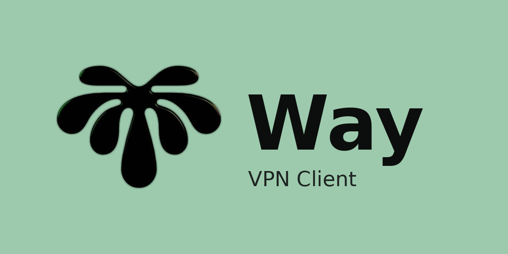

<p align="center">
  
</p>

<h1 align="center">Way</h1>

<p align="center">
  <b>EN</b> · <a href="#way-на-русском">RU</a>
</p>

<p align="center">
  <a href="https://github.com/mel0k1/way/actions/workflows/build.yml"></a>
  
  
  
  
  <a href="LICENSE"></a>
</p>

---

**Way** is a cross-platform VPN client built with **Flutter** (Material Design 3) and **Go**, powered by two engines: [sing-box](https://github.com/SagerNet/sing-box) and [Xray-core](https://github.com/XTLS/Xray-core). You can switch between cores at any moment without re-importing your servers.

## Features

- **Two cores, one app** — sing-box and xray-core live side by side; the active engine is a single tap in Settings
- **Material Design 3** — dynamic tonal palettes, large animated connect button, dark & light themes
- **TUN mode** — full-device tunneling via Android VpnService and system TUN on Windows
- **Subscriptions** — import by URL with automatic refresh every 30 minutes
- **RU + EN interface** — follows the system language, switchable in settings
- **Realtime stats** — live speed and connection counter via the clash API
- **NSIS installer** — a proper Windows setup with uninstaller, shortcuts and per-user system proxy

## Supported protocols

| Protocol | sing-box | xray |
| --- | :-: | :-: |
| VLESS (+ Reality, Vision, uTLS) | ✔ | ✔ |
| VMess | ✔ | ✔ |
| Trojan | ✔ | ✔ |
| Shadowsocks (incl. 2022) | ✔ | ✔ |
| Hysteria2 | ✔ | — |
| TUIC | ✔ | — |
| WS / gRPC / HTTP transports | ✔ | ✔ |

Links `vless://`, `vmess://`, `trojan://`, `ss://`, `hysteria2://`, `tuic://` are parsed automatically, both one by one and as a whole base64 subscription.

## Architecture

```
┌───────────────────────────── Flutter (MD3) ─────────────────────────────┐
│  home · servers · subscriptions · logs · settings (RU/EN, themes)       │
└──────────────┬───────────────────────────────────────────┬──────────────┘
               │ MethodChannel (Android)                   │ HTTP (desktop)
┌──────────────▼───────────────────┐   ┌───────────────────▼──────────────┐
│  WayVpnService (Kotlin)          │   │  waycore.exe (Go daemon)         │
│  libbox · VpnService · protect   │   │  /start /stop /status /ping      │
└──────────────┬───────────────────┘   └───────────────────┬──────────────┘
               │           ┌──────────────────────────────┐│
               └──────────►│  waycore (Go engine manager) │◄───────────────
                           │  sing-box  ──  xray-core     │
                           └──────────────────────────────┘
```

- **`core/`** — Go module `waycore`: engine manager, xray controller, HTTP control API, Windows system proxy
- **`lib/`** — Flutter app: link parser, config builder for both cores, subscriptions, MD3 UI
- **`android/`, `windows/`** — Flutter platform projects with the VpnService integration
- **`installer/`** — NSIS script for the Windows installer

## Download

Grab the latest APK and `WaySetup.exe` from [Releases](https://github.com/mel0k1/way/releases) or from the CI artifacts of every commit.

> **Windows TUN mode** requires administrator rights — run Way as administrator, otherwise use the proxy mode (system proxy is configured automatically).

## Build from source

Requirements: Go 1.27+, Flutter 3.47+, JDK 17, Android SDK/NDK (for Android).

```bash
git clone https://github.com/mel0k1/way.git
cd way

flutter pub get
flutter build apk --release
flutter build windows --release
```

The Go core is built automatically by CI; to build it manually:

```bash
cd core
go build -tags "with_gvisor,with_quic,with_utls,with_clash_api" -o waycore.exe ./cmd/waycore
```

## Disclaimer

This project is a client shell around open-source cores. It ships no servers, no keys and no default configurations. Use it in accordance with the laws of your jurisdiction.

## License

[GPL-3.0](LICENSE) — Way depends on sing-box (GPLv3) and Xray-core.

---

<a id="way-на-русском"></a>

<p align="center"></p>

## Way на русском

**Way** — кроссплатформенный VPN-клиент на **Flutter** (Material Design 3) и **Go** с двумя ядрами: [sing-box](https://github.com/SagerNet/sing-box) и [Xray-core](https://github.com/XTLS/Xray-core). Переключение между ядрами — в один тап, без реимпорта серверов.

### Возможности

- **Два ядра в одном приложении** — sing-box и xray-core, выбор движка в настройках
- **Material Design 3** — динамические палитры, большая анимированная кнопка подключения, тёмная и светлая темы
- **Режим TUN** — туннелирование всего трафика через VpnService на Android и системный TUN на Windows
- **Подписки** — импорт по ссылке с автообновлением каждые 30 минут
- **Интерфейс RU + EN** — следует языку системы, переключается в настройках
- **Статистика в реальном времени** — скорость и число соединений через clash API
- **NSIS-установщик** — полноценная установка на Windows с деинсталлятором и ярлыками

### Поддерживаемые протоколы

| Протокол | sing-box | xray |
| --- | :-: | :-: |
| VLESS (+ Reality, Vision, uTLS) | ✔ | ✔ |
| VMess | ✔ | ✔ |
| Trojan | ✔ | ✔ |
| Shadowsocks (вкл. 2022) | ✔ | ✔ |
| Hysteria2 | ✔ | — |
| TUIC | ✔ | — |
| Транспорты WS / gRPC / HTTP | ✔ | ✔ |

Ссылки `vless://`, `vmess://`, `trojan://`, `ss://`, `hysteria2://`, `tuic://` парсятся автоматически — по одной или целой base64-подпиской.

### Скачивание

Свежие APK и `WaySetup.exe` — в разделе [Releases](https://github.com/mel0k1/way/releases) или в артефактах CI каждого коммита.

> **Режим TUN на Windows** требует прав администратора — запускайте Way от администратора, иначе используйте режим прокси (системный прокси настраивается автоматически).

### Сборка из исходников

Нужны: Go 1.27+, Flutter 3.47+, JDK 17, Android SDK/NDK (для Android).

```bash
git clone https://github.com/mel0k1/way.git
cd way

flutter pub get
flutter build apk --release
flutter build windows --release
```

Go-ядро собирается автоматически в CI; вручную:

```bash
cd core
go build -tags "with_gvisor,with_quic,with_utls,with_clash_api" -o waycore.exe ./cmd/waycore
```

### Лицензия

[GPL-3.0](LICENSE) — Way использует sing-box (GPLv3) и Xray-core.
